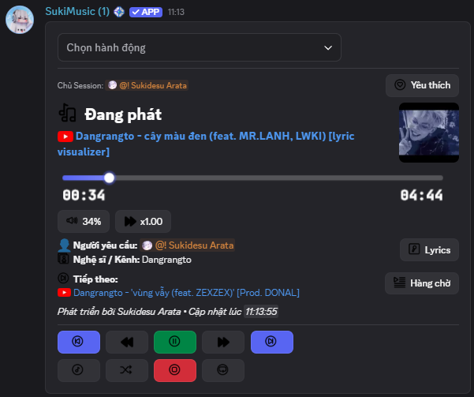
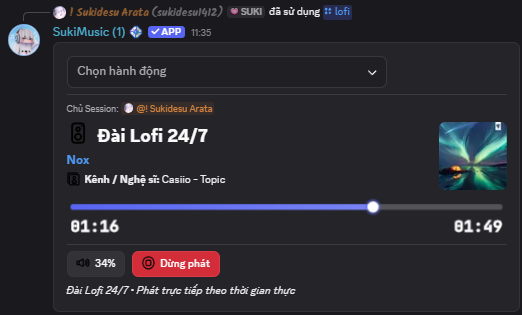
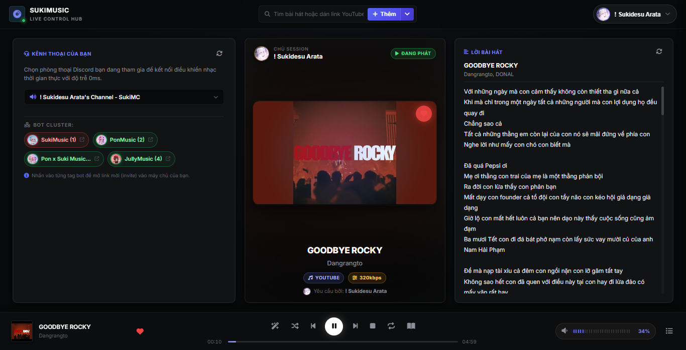
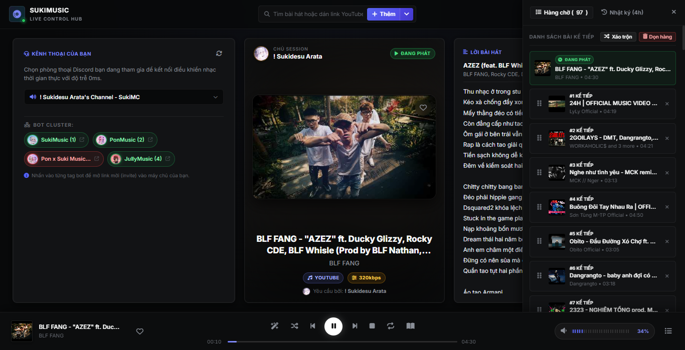

## SukiMusic — Nghe nhạc chất lượng cao & Audio Truyện 24/7
[Thêm vào Discord](https://discord.com/oauth2/authorize?client_id=1431131778067730462&permissions=281474980236352&integration_type=0&scope=bot+applications.commands) • [Tham gia Discord hỗ trợ](https://discord.gg/efj8JPqdG7)

---

### Tính năng chính
* **Đa nền tảng:** Hỗ trợ YouTube, Spotify, SoundCloud, Zing MP3 và NhacCuaTui.
* **Audio Truyện độc quyền:** Tìm kiếm và phát truyện audio tiếng Việt, tự động chuyển tập (`/autotruyen`), lưu và tiếp tục nghe qua danh sách truyện (`/truyen list`).
* **Đài Lofi 24/7:** Phát Lofi liên tục, tự động kết nối lại nếu bot khởi động lại.
* **Lời bài hát (Lyrics):** Tìm và hiển thị lời bài hát đồng bộ trực tiếp trong Discord.
* **Cá nhân hóa:** Tạo playlist riêng (`/playlist`), lưu bài hát yêu thích (`/fav`), nhớ âm lượng cá nhân (`/volume`), chỉnh tốc độ (`/speed`).
* **Các chế độ phát:** AutoPlay, Lặp bài (Loop), Trộn bài (Shuffle).
* **Điều khiển tiện lợi:** Hỗ trợ cả lệnh gạch chéo (`/`) và tiền tố (`+`), tích hợp nút bấm tương tác nhanh.

---

## Web Player điều khiển nhạc trực tiếp
Truy cập Dashboard: [Web Dashboard/Control](https://music.sukimc.me) • [Web status](https://music.sukimc.me/status)

* Quản lý danh sách phát, chỉnh âm lượng và chuyển bài trực tiếp trên trình duyệt máy tính hoặc điện thoại.
* Đồng bộ thời gian thực với phòng voice trong Discord.

---

## Hoàn toàn miễn phí
* Mở khóa sẵn toàn bộ tính năng (chỉnh âm lượng, phát 24/7, autoplay, audio truyện...).
* Không có paywall, không ép buộc vote để sử dụng tính năng.

---

## Bạn có câu hỏi hoặc cần hỗ trợ?
[Tham gia máy chủ Discord của chúng tôi](https://discord.gg/efj8JPqdG7)
